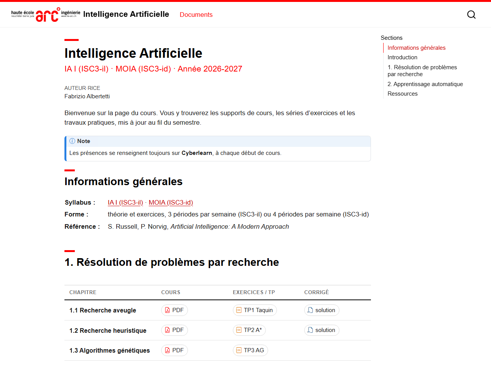

# Extension Quarto : site web de cours HE-Arc Ingénierie

Extension Quarto pour publier la page web d'un cours, qui liste les documents (PDF,
notebooks Jupyter, scripts Python…) classés par section. Le thème reprend la charte du logo
HE-Arc Ingénierie : rouge `#FF0000`, noir, fond blanc.



## Prérequis

- [Quarto](https://quarto.org) ≥ 1.4

## Installation

Dans le dépôt du cours :

```sh
quarto add fabrizioalbertetti/quarto_theme_hearc_websites
```

L'extension est installée dans `_extensions/fabrizioalbertetti/theme-hearc-websites/` (à
committer avec le cours). Pour partir de l'exemple complet (`_quarto.yml`, `index.qmd` et
documents d'exemple) :

```sh
quarto use template fabrizioalbertetti/quarto_theme_hearc_websites/example
```

Copier aussi [example/.gitignore](example/.gitignore) : Quarto ne copie pas les fichiers
cachés d'un template. Il ignore le site rendu (`_site/`) et le cache (`.quarto/`).

### Mise à jour

```sh
quarto update extension fabrizioalbertetti/quarto_theme_hearc_websites
```

## Utilisation

1. Adapter `_quarto.yml` :

   ```yaml
   project:
     type: website
     output-dir: _site
     render:
       - "*.qmd"         # ne pas rendre les notebooks de documents/

   course:               # sous-titre de la page : « name · class · year »
     name: "Intelligence Artificielle"   # omis du sous-titre s'il est le titre de la page
     class: "IA I (ISC3-il) · MOIA (ISC3-id)"
     year: "Année 2026-2027"
   author: "Fabrizio Albertetti"

   website:
     title: "Intelligence Artificielle"
     navbar:
       logo: _extensions/fabrizioalbertetti/theme-hearc-websites/logo-he-arc-ing.jpg

   format:
     theme-hearc-websites-html: default
   ```

   `render: ["*.qmd"]` est important : sans lui, Quarto convertirait chaque `.ipynb` du
   projet en page HTML au lieu de le proposer au téléchargement.

2. Placer les documents dans `documents/` (un sous-dossier par section, par exemple).

3. Dans `index.qmd`, une section par titre `##`, et dans chaque section un bloc
   `::: documents` contenant un **tableau** (une ligne par chapitre) ou une **liste**
   de liens (cartes), voir [Listes de documents](#listes-de-documents) :

   ```markdown
   ## 1. Résolution de problèmes par recherche

   ::: documents
   | Chapitre                   | Cours                    | Exercices / TP              | Corrigé                        |
   |----------------------------|--------------------------|-----------------------------|--------------------------------|
   | 1.1 Recherche aveugle      | [PDF](documents/1.1.pdf) | [TP1 Taquin](documents/tp1.ipynb) | [solution](documents/tp1-sol.py) |
   | 1.2 Recherche heuristique  | [PDF](documents/1.2.pdf) | [TP2 A\*](documents/tp2.ipynb)    | [solution](documents/tp2-sol.py) |
   :::
   ```

4. Générer ou prévisualiser le site :

   ```sh
   quarto preview      # rendu automatique à chaque sauvegarde
   quarto render       # site complet → _site/ (à publier, par ex. GitHub Pages)
   ```

## En-tête du cours

Avant les sections de documents, `index.qmd` peut présenter le cours (voir l'exemple) :

| Élément                              | Syntaxe                                            |
|--------------------------------------|----------------------------------------------------|
| Encadré « Note »                     | `::: callout-note` … `:::` (aussi `callout-warning`, `callout-tip`…) |
| Informations sur deux colonnes       | liste de définitions : `Terme` puis `: définition` à la ligne suivante |
| Cartes côte à côte (empilées sur mobile) | `:::: {.grid}` + `::: {.g-col-12 .g-col-md-6 .hearc-card}`, titre `[Titre]{.hearc-card-title}` |

## Listes de documents

Un bloc `::: documents` peut contenir :

- **un tableau** : une ligne par chapitre, une colonne par sorte de document (colonnes
  libres). Chaque lien devient un badge compact (icône du type ; type et taille au
  survol) ; plusieurs liens par cellule sont possibles
  (`[énoncé](tp4.pdf) [notebook](tp4.ipynb) [utils.py](utils.py)`). Les colonnes sont
  alignées d'un tableau à l'autre (chapitre : 30 %) ; sur mobile, chaque ligne est
  empilée (chapitre, puis badges). Une cellule vide reste vide ;
- **une liste à puces** de liens : chaque puce devient une carte cliquable avec
  description (texte après le lien), taille et type.

Les deux formes suivent les mêmes règles :

| Fichier            | Icône / libellé | Au clic                    |
|--------------------|-----------------|----------------------------|
| `.pdf`             | PDF             | ouvert dans un nouvel onglet |
| `.ipynb`           | Notebook        | téléchargé                 |
| `.py`              | Python          | téléchargé                 |
| `.zip`, `.csv`     | Archive, Données | téléchargé                |
| `https://…`        | Lien            | ouvert dans un nouvel onglet |
| autre              | Fichier         | ouvert par le navigateur   |

- Cartes : le texte après le lien (séparateur `—`, `:` ou `-` facultatif) est la
  description ; `{.solution}` après le lien ajoute un badge « corrigé ».
- La taille du fichier est calculée automatiquement.
- Un fichier local absent est **masqué automatiquement** (et listé dans un avertissement
  au rendu) : on peut lister à l'avance tous les documents du semestre, chacun apparaît
  dès que son fichier est déposé dans `documents/` et le site regénéré. Les liens
  externes (`https://…`) ne sont pas vérifiés.
- Pour annoncer un document absent plutôt que le masquer : `{.soon}` après le lien
  l'affiche grisé, « bientôt disponible », sans lien. Pour tous les documents du site
  ou d'une page (`_quarto.yml` ou en-tête du `.qmd`) :

  ```yaml
  documents:
    missing: soon    # défaut : hide
  ```

## Masquer un document ou une section

Seuls les fichiers liés depuis une page sont copiés dans `_site/` (ne pas ajouter
`documents/` aux `resources` du projet). Un élément masqué n'est donc ni affiché ni
publié, et n'apparaît pas dans la recherche :

| Masquer               | Syntaxe                                                          |
|-----------------------|------------------------------------------------------------------|
| un document           | `{.hidden}` après le lien : `- [Examen blanc](documents/examen.pdf){.hidden}` |
| une section entière   | l'entourer de `::: content-hidden` … `:::` (titre, texte et documents) |
| n'importe quel texte  | `::: content-hidden` … `:::`, ou `[texte]{.content-hidden}` dans une phrase |

Pour publier, retirer `.hidden` ou les lignes `:::`, puis `quarto render`.

Ne pas utiliser de commentaire `<!-- … -->` pour cacher un contenu aux étudiants : il
est recopié dans le source HTML de la page publiée.

Le reste de la page est du Markdown ordinaire (texte d'introduction, sous-sections `###`,
tableaux…). Les sections `##` apparaissent dans la table des matières à droite.

## Structure du dépôt

```
_extensions/theme-hearc-websites/   l'extension Quarto (installée par `quarto add`)
  _extension.yml                    format `theme-hearc-websites-html`
  hearc-web.scss                    thème (couleurs, titres, cartes des documents)
  documents.lua                     blocs `::: documents` ; sous-titre depuis `course`
  logo-he-arc-ing.jpg               logo de la barre de navigation
example/                            site d'exemple qui utilise l'extension
  _quarto.yml                       configuration du site et du cours
  index.qmd                         page des documents, commentée
  documents/                        PDF, notebooks et scripts d'exemple
  images/                           capture d'écran du README
```

## Développement

L'exemple utilise une copie de l'extension (`example/_extensions/`). Après chaque
modification dans `_extensions/`, la recopier puis regénérer l'exemple :

```sh
cp _extensions/theme-hearc-websites/* example/_extensions/fabrizioalbertetti/theme-hearc-websites/
cd example && quarto render     # → example/_site/
```

## Personnalisation

- **Couleurs, polices, cartes** : `hearc-web.scss`. Pour une modification propre à un cours,
  éditer la copie installée dans ce cours.
- **Types de fichiers** : table `TYPES` en tête de `documents.lua` (icônes
  [Bootstrap Icons](https://icons.getbootstrap.com)).
